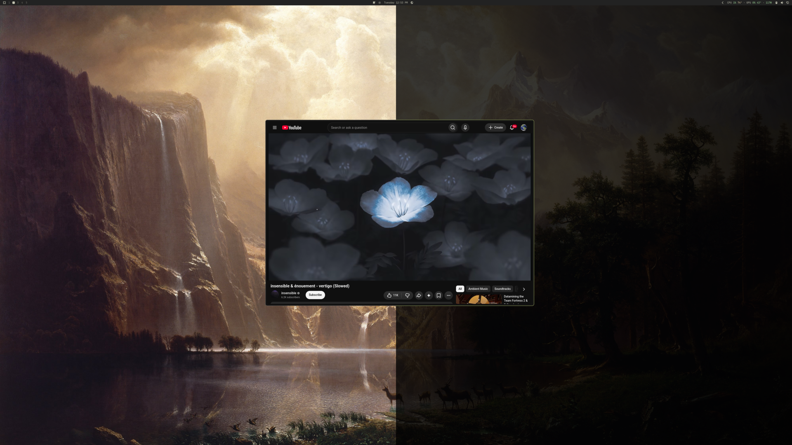

# Dim Wallpaper

An [Omarchy](https://omarchy.org/) bar widget that dims your wallpaper behind your windows with one click, so the app on screen takes center stage.



## Features

- One click to dim, one click to bring the wallpaper back
- Right-click for a darkness slider (10% to 100%) that previews live as you drag. 100% is true black, which switches OLED pixels fully off
- Your darkness is saved as the default and survives restarts
- Smooth theater-style fade: the wallpaper glides into the dark, with a soft vignette that pulls your eye to the center
- Fade timing runs on its own clock, so it stays smooth on mixed-refresh setups (for example a 240Hz and a 165Hz monitor)
- Stays out of the way: the icon hides while off and appears when you hover the bar, like Omarchy's built-in indicators
- Only the wallpaper dims. Your windows, bar, and notifications stay at full brightness
- Every monitor dims together
- Click-through: the dim layer never blocks the mouse
- Respects `omarchy toggle animations`: with animations off, it switches instantly

## Install

```bash
omarchy plugin add https://github.com/michaelsucks/DimWallpaper --enable
```

## Remove

```bash
omarchy plugin remove io.github.michaelsucks.dim-wallpaper
```

This takes the widget off the bar and deletes the plugin folder. The plugin never changes your config. The only file it writes is your saved darkness, at `~/.local/state/dim-wallpaper-darkness`; delete it too if you want a completely clean removal.

## Usage

Click the light-bulb icon in the bar to toggle. The icon lights up while the wallpaper is dimmed, and hides while it's off (hover the bar to reveal it).

Right-click the icon to open the darkness slider. Drag to preview, let go to save it as your default; the menu closes on its own.

### Keybinding / scripting

While the widget is on the bar, it exposes an IPC target, so you can bind it to a key in `~/.config/hypr/bindings.lua`:

```bash
omarchy-shell io.github.michaelsucks.dim-wallpaper toggle
omarchy-shell io.github.michaelsucks.dim-wallpaper enable
omarchy-shell io.github.michaelsucks.dim-wallpaper disable
omarchy-shell io.github.michaelsucks.dim-wallpaper darkness 85   # percent, 10-100
```

## How it works

The plugin places one full-screen, transparent layer on each monitor, on the Wayland layer between the wallpaper and your windows. Toggling it fades that layer's opacity, so only the wallpaper gets darker. The layer is always present but invisible when off, which keeps the fade smooth from the very first frame.

## License

MIT
